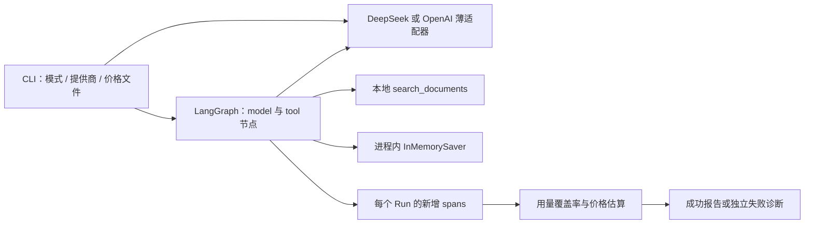

# 新环境接续审视记录

核对日期：2026-10-15（Asia/Shanghai）。核对起点：`work` 分支 `17c19c21dc49ceb17e3e960e3d632490627c5f26`，本地与远程一致，工作区干净。本次完成项目审视、环境复核和一次真实 M0 验证；未开发 M1 或修改运行代码。

**后续状态：**M0-07 已修复异常响应观测，63 项测试通过；用户随后确认以真实用量及可追溯估算完成 M0，实际账单另列待办，进入 M1。下文保留审视时的历史发现；当前状态以 [HANDOFF](../HANDOFF.md) 和 [M0 验收结论](m0-acceptance.md)为准。

## 1. 结论与项目定位

项目可以在新环境接续，已提交的代码和设计没有缺失。旧环境的 DeepSeek 网络阻塞在本环境未复现：通过继承的代理和正常 SDK，鉴权、模型列表及两次 Chat Completions 请求均成功。

AgentTinker 的目标是让用户围绕同一个实验完成“观察执行 → 定位失败 → 修改一个因素 → 创建新运行 → 对比证据”。Learn、Playground、Builder、Debugger、Evaluation、Explore 共享实验、运行与评价数据；首版将最小能力放进一个工作台，而非一次开发六套独立系统。

当前工程是 **M0 技术验证 CLI**。真实 LangGraph checkpoint、真实 DeepSeek 请求和本地只读检索已经一起运行；完整 ReAct、服务端、网页、持久化与产品验收仍待实现。M0 真实分支检查已通过，用量和价格估算已核对；逐笔实际扣费仍无可核对凭证，因此 M0 整体保持进行中，M1 未开始。

## 2. 审视范围与上下文恢复

已读取核对起点的全部 33 个受 Git 跟踪文件：

| 文件组 | 核对内容 |
| --- | --- |
| 根目录 4 份 Markdown | AGENTS、HANDOFF、README、CONTRIBUTING 的开发规则与接续入口 |
| docs 下 6 份文档 | 竞品研究、产品、架构路线、云配置、M0 验证和开发日志 |
| src 下 10 个 Python 文件 | 包入口、模型契约、夹具、模拟器、SDK 适配、执行图、用量费用和 CLI |
| tests 下 5 个文件 | 分支不变性、参数校验、SDK 模拟 HTTP、失败诊断、费用与覆盖率 |
| examples 下 3 个 JSON | synthetic 记录、Flash 高峰和低峰价格 |
| 工程配置与脚本 | pyproject、uv.lock、setup.sh、.env.example、.gitignore |

锁文件包含 49 个包，安装使用 `--locked`；没有升级依赖。读取了两条引用聊天：ChatGPT「解释个人主页功能」确认长期愿景，Codex「开发推进」确认命名、复用含义、范围变更及小步验证提交的约定。仓库源码、提交和本次运行证据用于判断实际进度，旧聊天不替代环境实测。

继续遵守：正式名 AgentTinker，仓库暂用 AgentTinker-preview；沿用 work 和既有 Git 身份；每个独立节点验证、记日志、提交推送；产品范围或关键架构变更另行讨论。复用成熟引擎、SDK、组件和适合移植的模块，仍实现统一的自身产品体验。

## 3. 代码如何运行



| 入口 | 已核实的职责与边界 |
| --- | --- |
| [probe.py](../src/agenttinker/m0/probe.py) | 两节点串行图；工具前 checkpoint；只允许修改重试次数和 top_k；显式保存各 Run 的终点；沿祖先核对历史 |
| [models.py](../src/agenttinker/m0/models.py) | M0 模型输出、工具策略与 span；尚非 M1 正式对象/事件协议 |
| [fixtures.py](../src/agenttinker/m0/fixtures.py) | 三份虚构发布说明、稳定检索顺序与内容哈希；没有实时网页搜索或 read_document 工具 |
| [synthetic.py](../src/agenttinker/m0/synthetic.py) | 明确标记的确定性模拟模型；不伪造 Token 与费用 |
| [openai_model.py](../src/agenttinker/m0/openai_model.py)、[deepseek_model.py](../src/agenttinker/m0/deepseek_model.py) | 复用官方 OpenAI SDK；保留请求和响应；DeepSeek 禁用 thinking，使用 max_tokens；关闭 SDK 自动重试 |
| [accounting.py](../src/agenttinker/m0/accounting.py) | 校验 Token 总数与缓存分解；只汇总新增调用；用 Decimal 和明确价格版本估算；缺失保持未知 |
| [cli.py](../src/agenttinker/m0/cli.py) | 强制选择 live/synthetic；缺配置不降级；原子写报告；失败报告独立保存 |

A 首次模型调用产生工具调用，工具首次 attempt 注入超时；无重试时 A 失败。B 从 A 的工具前 checkpoint 派生，只改 `tool_retry_limit=1`，保留查询和 tool call ID。B 的第一次 attempt 仍超时，第二次检索成功，再新增一次模型请求生成回答。B 不重调 A 的模型前缀，也不重复计费。

## 4. 当前环境与验证

| 项目 | 本次实测 |
| --- | --- |
| 目录 / 分支 | `/workspace/AgentTinker-preview` / work |
| Python / uv | 3.12.14 / 0.12.23 |
| Node / npm | 24.19.0 / 11.9.0；前端工程尚未建立 |
| 锁定依赖 | LangGraph 1.2.14、checkpoint 4.2.0、OpenAI SDK 2.54.0、Pydantic 2.13.5 |
| 网络与凭据声明 | 当前配置包含 unrestricted 网络、DeepSeek 秘密绑定与模型变量；状态接口仍返回 unknown，不能称其 ready/enforced |
| 实际访问 | 无鉴权 HEAD 到达 DeepSeek 返回 401；鉴权模型列表 HTTP 200，包含 deepseek-flash；真实推理成功 |
| 密钥处理 | 仅检查注入和使用结果，未打印值；保留平台代理、TLS 与凭据注入机制 |
| 安装 | 默认 uv 缓存位于只读目录；指定 `/tmp/agenttinker-uv-cache` 后固定安装入口成功 |
| 网络命令权限 | 命令工具启用网络权限后成功；没有改写网络策略或绕过代理 |
| 本地数据 | artifacts 和 .venv 为本地忽略产物，旧环境未提交文件及 checkpoint 未恢复 |

执行结果：47 项 pytest 通过；ruff 检查通过；25 个 Python 文件格式检查通过；synthetic CLI 的 7 项检查通过；文档本地链接有效。安装与 uv 命令使用 `UV_CACHE_DIR=/tmp/agenttinker-uv-cache`。

## 5. 本次真实 M0 证据

调用时段为北京时间 **2026-10-15 20:14:16–20:14:19**（UTC 12:14）。当日重新核对了官方 [模型价格](https://api-docs.deepseek.com/quick_start/pricing/)、[工具调用](https://api-docs.deepseek.com/guides/tool_calls/)和 [Chat Completions 协议](https://api-docs.deepseek.com/api/create-chat-completion/)。调用时段在工作日高峰窗口之外，显式选择已有低峰价格快照；程序没有自动推断时段。

```bash
UV_CACHE_DIR=/tmp/agenttinker-uv-cache uv run agenttinker-m0 \
  --mode live --provider deepseek \
  --pricing examples/m0/pricing-deepseek-flash-off-peak.json \
  --output artifacts/m0-resume-deepseek-live.json
```

本次实际通过 `.venv/bin/agenttinker-m0` 执行上述相同参数。可分发记录保存于 [deepseek-retry-live.json](../examples/m0/deepseek-retry-live.json)；检查过密钥值及认证字段，内容仅为实验夹具、模型请求响应和执行证据。账户余额响应不入库。

| 指标 | A | B 新增部分 |
| --- | --- | --- |
| 状态 | failed，预期注入超时 | succeeded |
| 新模型调用 / 逻辑工具调用 | 1 / 1 | 1 / 1 |
| 工具 attempts | 1 | 2 |
| 输入 / 输出 Token | 341 / 33 | 179 / 81 |
| 总 Token | 374 | 260 |
| 缓存命中 / 未命中 | 0 / 341 | 0 / 179 |
| 价格表估算 USD | 0.00007095 | 0.00007545 |

实际返回的模型 ID 均为 `deepseek-flash`。7 项检查全部 true；A 的 4 个 checkpoint 和原始 evidence 均不变；B 保留原 tool call。634 个 Token 和合计 **0.00014640 USD** 是两次新增请求的总量与估算，不包含重复计入的前缀。用量覆盖率与费用覆盖率均为 1/1，并独立复算了 Decimal 金额。

该报价仍为 2026-10-08 采集的快照，本次核对单价未变：未缓存输入 / 缓存输入 / 输出每百万 Token 分别为 0.15 / 0.003 / 0.6 USD。它不等于实际账单。官方 [余额接口](https://api-docs.deepseek.com/api/get-user-balance/)查询成功，账户可用，返回 CNY；没有逐请求费用，也没有本次调用前的有效余额快照，不能据此反推美元扣费或声称费用验收完成。本次外部核对脚本最初使用 SDK 的 `cast_to=dict` 触发本地 ValueError，改用原始 HTTP response 后查询成功；这不是 DeepSeek 鉴权或服务故障，仓库运行代码未受影响。

## 6. 发现的问题与优先级

1. **M0 费用验收未闭合。** 真实调用、历史不变和新增用量已有证据；实际扣费尚无法逐笔对应。先获取可对应请求或明确时段的账户用量/费用记录，保留币种及价格依据。不能把余额可用或价格表估算当成账单。
2. **异常响应可能丢失已返回用量，已离线复现，后续 M0-07 已修复。** 原 `OpenAIModel.complete()` 在 `choices` 数量不为 1 时先抛异常，尚未构造带 usage/raw_response 的 ModelOutput。`probe._model()` 因此只记录调用失败；即使 HTTP 200 已携带 usage，报告仍为 null，并把阶段记为 model_call。审视时仅记录发现；后续修复为先保存响应观测，再在 model_protocol 阶段拒绝执行，新增 16 项离线回归，当前共 63 项测试通过。详见 [M0 验证说明](m0-validation.md#异常响应验证m0-07)。
3. **M0 能力不能直接扩写成产品承诺。** 内存 checkpoint 不能跨进程恢复；首次调用被强制选择工具；注入超时是固定逻辑事件；尚无 read_document、完整 ReAct、取消、真实流式事件、API 或 UI。这些属于既定后续任务，不能因本次 live 成功改记为已实现。
4. **旧环境状态需要退出当前断点。** 文档中的“没有密钥、代理 403”只适用于旧环境历史。本次已同步当前说明；旧日志保留以解释迁移原因，不继续要求用户重复配置已经实测可用的密钥。

## 7. 后续阶段与接续次序

| 阶段 | 状态与下一项工作 |
| --- | --- |
| M0 | 真实分支已验证，异常响应观测随后在 M0-07 修复；实际费用仍待核对，保持进行中 |
| M1 | 未开始；CORE-01 定义对象/事件 schema 和状态机，再做 STORE-01、SQLite、事件追加与 SSE 续传去重；涵盖失败、重试、取消及中断 |
| M2 | 未开始；React/TypeScript/Vite、列表/图、详情与时间线；播放记录不调用模型 |
| M3 | 未开始；完整超时实验、允许边界的 fork、A/B 证据对比与讲解，保留真实参考案例 |
| M4 | 未开始；第二个检索实验、评价、实验包导入导出、无密钥回看 |
| M5 | 未开始；与 Studio/Phoenix 同案例实操及小规模使用验证 |

M1 起仍按 [架构路线](03-architecture-roadmap.md)和 [P01–P10](02-product-design.md#8-验收标准)判断完成，不能把 M0 JSON 报告当成持久化服务或完整参考实验包。本次不改变阶段依赖、产品定位、技术路线或费用验收条件。
